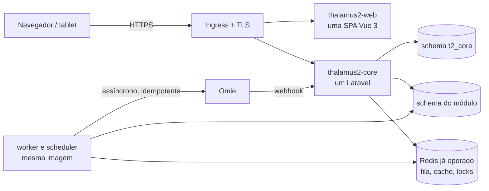

# Infraestrutura de deploy do Thalamus 2.0

Documento técnico da infraestrutura que o Thalamus 2.0 passa a usar a partir de agora, ainda com o sistema em desenvolvimento. O objetivo é montar a esteira antes de o sistema crescer, para que cada módulo novo já nasça publicável, observável e isolado.

O Thalamus 2.0 é um produto independente: tem repositórios, autenticação, banco e publicação próprios.

Base da decisão:

- Parecer do DevOps (áudios de 20/10/2026).
- Fronteiras já registradas em `docs/arquitetura-erp-v3.md` e `docs/contrato-backend-orcamentos.md`.
- Plataforma que a Roboflex já opera: GitHub, Docker Hub e Kubernetes com Rancher.

Status: **em construção**. As decisões fechadas estão na seção 14. O que ainda depende do DevOps está na seção 15.

---

## 1. Regras que a infraestrutura já nasce cumprindo

| Regra | Como aparece no deploy |
| --- | --- |
| A versão publicada é identificável | Imagem com tag `sha-<commit>` e, em produção, `vAAAA.MM.N`. Sem tag mutável |
| O que está no git é o que está rodando | Manifestos Kubernetes no repositório `thalamus-infra`. Voltar versão é reverter um commit |
| Homologação e produção recebem a mesma imagem | `main` publica em homologação; a tag de versão promove essa imagem |
| A rotina agendada mora no produto | Deployment `thalamus2-scheduler`, uma réplica, definido no git |
| A API e as filas longas são processos distintos | Deployments separados, mesma imagem, comando diferente |
| Arquivo sobrevive a reinício | Armazenamento de objetos, com URL assinada |
| Fila tem painel e falha visível | Redis + Horizon, alerta quando a fila do Omie acumula |
| Segredo fica fora do git | `.env.example` só com nomes; valor cifrado no repositório de infraestrutura |
| O cluster sabe se a aplicação está pronta | `GET /health/live` e `GET /health/ready` |
| Um endereço para o ERP | Uma aplicação Vue, uma imagem, um domínio |

---

## 2. Parecer do DevOps

Resumo do que vale para o 2.0:

1. Ter uma estratégia. Código gerado com IA precisa continuar fácil de manter pela equipe.
2. Cada módulo tem o próprio schema. Por enquanto **um Laravel só, uma instância MySQL, um schema por módulo**. Módulo não lê o schema do outro.
3. Enquanto o produto atende a Roboflex, a fronteira entre schemas pode ser uma chamada interna. Se for vendido para outras empresas, a mesma fronteira vira HTTP e o acoplamento cai.
4. Começar por um **projeto piloto**, com especificação padronizada, e repetir o padrão nos módulos seguintes.

| Recomendação | Decisão aqui |
| --- | --- |
| Schema por módulo | Adotada desde o primeiro módulo (seção 6) |
| Comunicação por API | Adotada: módulo lê só o próprio schema; o restante é contrato ou evento (seção 5) |
| Backend por módulo | Adiada. Por enquanto um repositório Laravel. A separação é o schema. Um processo por módulo fica para quando houver motivo de publicar aquele pedaço sozinho |
| Projeto piloto | O primeiro módulo que sair do mockup ensina o padrão. O restante do sistema continua funcional nesse meio-tempo (seção 12) |
| Especificação padronizada para IA | Documento formal, mockup, contrato e testes passam a ser exigência da esteira (seção 12) |

---

## 3. Visão geral



Princípios:

1. **Plataforma conhecida, disciplina nova.** GitHub Actions, registro de imagens e Kubernetes com Rancher. A publicação usa tag imutável, manifesto no git e promoção da mesma imagem.
2. **Um frontend.** Os módulos são rotas e pastas da mesma aplicação Vue. O navegador baixa só o módulo aberto.
3. **Dois repositórios por enquanto.** O frontend é uma SPA. O backend é um Laravel, com um schema por módulo na mesma instância MySQL. Todo dado de negócio pertence a uma empresa (`tenant_id`). Módulo não consulta o schema alheio; pede o dado ao código daquele módulo.
4. **Um processo por papel.** HTTP, workers e scheduler são deployments diferentes da mesma imagem.
5. **Estado fora do pod.** Banco, Redis e armazenamento de objetos guardam o que precisa sobreviver a um reinício.
6. **Autenticação própria.** Usuários, perfis, empresas, grupos econômicos e sessão nascem no schema `t2_core`, dentro do mesmo Laravel. Perfis concedem funcionalidades e podem ser atribuídos em conjunto; Administrador é imutável e sempre recebe tudo.

O modelo completo de tenant, grupo econômico, autorização consolidada e propagação de contexto está em `docs/multitenancy.md`.

---

## 4. Frontend: uma aplicação, módulos por dentro

### O que é microfrontend

Microfrontend é publicar cada módulo como uma aplicação de frontend independente, com build, versão e deploy próprios, e juntá-las no navegador. As formas comuns são Module Federation (Vite ou Webpack), single-spa, iframe, ou um site por subdomínio com bibliotecas npm compartilhadas.

Isso existe para um problema específico: vários times, em ritmos diferentes, às vezes com tecnologias diferentes, entregando pedaços de um mesmo produto.

### O que cabe na Roboflex

A Roboflex tem uma equipe, um produto e um desenho só. Os módulos compartilham sessão, permissão, menu e dados: uma demanda vira compra, a compra mexe no orçamento, o orçamento aparece no sino. O código é escrito com IA a partir de uma especificação, e a equipe precisa manter um padrão só.

Nessa realidade, microfrontend cobra um preço alto e entrega pouco:

- cada módulo ganha pipeline, imagem, domínio e versão;
- sessão, menu e visual precisam de um contrato extra entre aplicações;
- uma mudança que atravessa dois módulos (o caso normal do ERP) espera dois deploys;
- a IA passa a manter vários padrões em vez de um.

### Decisão

O frontend do Thalamus 2.0 é **uma aplicação Vue**, neste repositório.

| Camada | Como fica |
| --- | --- |
| Módulo | Pasta própria: `src/views/<modulo>`, `src/domain`, rotas em `src/router` |
| Carregamento | Rota com import dinâmico. Quem abre Orçamentos baixa o pacote de Orçamentos; o restante fica para quando for aberto |
| Visual e sessão | Um design system, um login, um menu |
| Publicação | Uma imagem `thalamus2-web`, um domínio |
| Teste | `vue-tsc`, ESLint, Vitest e build, como no `AGENTS.md` |

O tablet do chão de fábrica pode virar **um segundo aplicativo** no dia em que precisar de ciclo próprio: tela cheia, posto fixo, rede instável. Esse segundo app consome a mesma API. Ele é outro cliente, com outro deployment, e continua fora da composição de microfrontends.

---

## 5. Aplicações e unidades de deploy

### 5.1 Repositórios

Por enquanto são dois. A área do menu não abre repositório.

| Repositório | Conteúdo | Quando |
| --- | --- | --- |
| `thalamus-2.0` | Frontend único | Existe |
| `thalamus-2-core` | Backend Laravel inteiro. Módulos são pastas; a fronteira entre eles é o schema | Agora. A pasta local é `C:\Users\Mari\Documents\GitHub\thalamus-2-core` |
| `thalamus-infra` | Manifestos Kubernetes (Kustomize), políticas e runbooks | Só na publicação |

Dentro do `thalamus-2-core`, cada módulo usa só o próprio schema: `t2_core`, `t2_orcamentos`, `t2_cadastros`, `t2_suprimentos`, `t2_comercial`, `t2_operacoes`. Finanças, quando for evoluída, é o orçamento em `t2_orcamentos`. Indicadores leem os outros módulos pelo código deles, sem schema próprio. O esboço inteiro continua usável no frontend enquanto o schema correspondente ainda não existe.

### 5.2 Deployments por ambiente

| Deployment | Imagem | Réplicas (hml / prd) | Papel |
| --- | --- | --- | --- |
| `thalamus2-web` | `devroboflex/thalamus2-web` | 1 / 2 | SPA em `nginx-unprivileged`, com fallback de rota para `index.html` |
| `thalamus2-core` | `devroboflex/thalamus2-core` | 1 / 2 | HTTP de todos os módulos (PHP-FPM + nginx no mesmo pod, ou FrankenPHP) |
| `thalamus2-core-worker` | mesma imagem | 1 / 2 | `php artisan horizon` |
| `thalamus2-core-scheduler` | mesma imagem | 1 / 1 | `php artisan schedule:work` |
| `thalamus2-core-migrate` (Job) | mesma imagem | sob demanda | Migrations, schema por schema, começando por `t2_core` |

O scheduler e as migrations ficam definidos no git, no mesmo repositório de infraestrutura.

### 5.3 Um Laravel, um schema por módulo

O repositório tem esta forma:

```text
app/Modules/<Modulo>/
  Http/        rotas, controllers, form requests
  Domain/      regras transacionais
  Database/    migrations do schema do módulo
  Jobs/        fila do módulo
```

Regras desde o primeiro commit:

- Cada módulo usa a própria conexão de banco, no próprio schema, com usuário limitado a esse schema. Toda tabela de negócio recebe `tenant_id`.
- Módulo não lê o schema de outro. O dado alheio entra por uma chamada ao código daquele módulo, ou por evento.
- O schema `t2_core` é a única fonte de usuário, empresa, grupo econômico e permissão. Os outros módulos recebem o contexto já resolvido.
- Eventos de domínio (`PrevisaoRegistrada`, `NotaOmieRecebida`) passam por uma tabela de *outbox* no schema de quem emite e saem pela fila.
- Separar um módulo em outro repositório fica para quando ele precisar de publicação própria. Até lá, a fronteira é o schema.

---

## 6. Banco de dados

| Tema | Decisão |
| --- | --- |
| Motor | MySQL 8, na mesma hospedagem já operada hoje. Nesta fase não se contrata banco gerenciado |
| Instância | Uma por ambiente, a que já existe. Homologação e produção usam instâncias diferentes. O 2.0 entra com schemas novos, sem tabela compartilhada |
| Redis | A instância já operada no ambiente. Fila, cache e lock do 2.0 usam prefixo próprio. Não se contrata Redis gerenciado nesta fase |
| Schemas | No mesmo MySQL: `t2_core`, `t2_orcamentos`, `t2_cadastros`, `t2_suprimentos`, `t2_comercial`, `t2_operacoes`, criados quando o módulo correspondente entrar no Laravel. O nome é fixo; o ambiente é a instância. Cada tabela de negócio é isolada por `tenant_id` |
| Usuários | Um usuário de aplicação por schema, com `SELECT, INSERT, UPDATE, DELETE`. Um usuário de migração por schema, usado só pelo Job |
| Migrations | Por módulo, no Job `thalamus2-migrate`, antes do rollout. Em produção, só com aprovação no GitHub Environment |
| Mudança de schema | Compatível com a versão anterior (expandir, migrar, contrair), para voltar a imagem sem voltar o banco |
| Backup | Dump lógico diário por schema e binlog para recuperação pontual. Retenção de 30 dias em produção. Teste de restauração mensal, registrado |
| Concorrência | Lock por tenant, categoria e período; índices únicos incluem `tenant_id`; eventos externos também incluem o tenant |

Se o produto for vendido para outras empresas, a mesma separação evolui para instância ou schema por cliente, com o código dos módulos estável.

---

## 7. Ambientes e domínios

| Ambiente | Onde | Domínios | Dados | Omie |
| --- | --- | --- | --- | --- |
| Local | `docker compose` no repositório da API (MySQL, Redis, MinIO, Mailpit) | `localhost` | Seed | Simulado |
| Homologação | Namespace `thalamus2-hml` | `erp-homologacao.thalamus.ind.br` e `api-erp-homologacao.thalamus.ind.br` | Seed | Conta Omie de testes |
| Produção | Namespace `thalamus2-prd` | `erp.thalamus.ind.br` e `api-erp.thalamus.ind.br` | Reais | Conta Omie da Roboflex |
| Demonstração | GitHub Pages do repositório `thalamus-2.0` | `zontec-software.github.io/thalamus-2.0` | localStorage do navegador | Simulado |

Os nomes de domínio ainda estão em aberto (seção 14). A autenticação é a do próprio 2.0.

Homologação e produção esperam o login e as permissões. O mockup navegável sai à parte: o workflow `.github/workflows/pages.yml` publica o build estático a cada push na `main`. Essa demonstração não tem banco, login nem Omie real.

---

## 8. Esteira de entrega

### 8.1 Fluxo

| Evento | O que acontece |
| --- | --- |
| Pull request para `main` | Verificações obrigatórias. Nada é publicado |
| Merge em `main` | A imagem é construída uma vez, com tag `sha-<commit>`, e vai para homologação |
| Tag `vAAAA.MM.N` | A mesma imagem ganha a tag da versão e segue para produção, com aprovação no GitHub Environment `producao` |

A imagem testada em homologação é a que chega à produção.

### 8.2 Verificações obrigatórias

Frontend (`thalamus-2.0`):

```bash
npx vue-tsc --noEmit -p tsconfig.app.json
npx eslint src
npx vitest run
npm run build
```

Backend (`thalamus-2-core`):

```bash
composer validate --strict
vendor/bin/pint --test
vendor/bin/phpstan analyse
php artisan test        # inclui o teste de fronteira entre módulos
```

Nos dois: build da imagem, varredura de vulnerabilidades (Trivy) com falha em severidade crítica, e verificação de segredo commitado (gitleaks).

### 8.3 Do git até o cluster

Os manifestos ficam em `thalamus-infra`, com Kustomize:

```text
thalamus-infra/
  apps/thalamus2/
    base/                 deployments, services, ingress, HPA, PDB, probes
    overlays/
      homologacao/        réplicas, domínios, recursos, tag da imagem
      producao/
```

O workflow grava a tag nova no overlay (commit em homologação, pull request aprovado em produção). O Rancher Fleet sincroniza o cluster a partir desse git.

Se o DevOps preferir `kubectl` na esteira, o comando é `kubectl apply -k overlays/<ambiente>`, com a tag imutável.

### 8.4 Imagens

| Imagem | Base | Observações |
| --- | --- | --- |
| `thalamus2-web` | build `node:22-alpine` → `nginxinc/nginx-unprivileged:1.27-alpine` | A configuração do ambiente entra na subida do contêiner (`/config.js`), e a mesma imagem serve homologação e produção. `try_files $uri /index.html`, porque o router usa histórico HTML5. Cache longo em `/assets/*` e `no-cache` no `index.html` |
| `thalamus2-core` | `php:8.3-fpm-alpine` + nginx, ou FrankenPHP | Extensões `pdo_mysql`, `redis`, `bcmath`, `intl`, `gd`, `zip`, `opcache`. Usuário sem root. `.dockerignore` obrigatório. Um processo por contêiner; o papel vem do comando do deployment |

Node 22 LTS no build também cobre o Vite 8, que pede Node 20.19 ou mais.

---

## 9. Configuração, segredos e segurança

- O repositório traz `.env.example` com os nomes. O valor fica fora do git.
- Segredos de execução (banco, Omie, sessão, armazenamento) ficam em Secrets do Kubernetes, cifrados com Sealed Secrets ou External Secrets e versionados em `thalamus-infra`.
- Segredos da esteira ficam em GitHub Environments, com revisor obrigatório em `producao`.
- A conta Omie de testes e a de produção são credenciais diferentes.
- Ingress com TLS (cert-manager), HSTS e cabeçalhos de segurança no nginx.
- `NetworkPolicy`: banco e Redis aceitam conexão da API, dos workers e do scheduler do próprio namespace.
- A API verifica o perfil em toda operação. A tela apenas esconde o que o perfil não pode fazer.

---

## 10. Integrações e serviços de apoio

| Serviço | Decisão |
| --- | --- |
| Omie | Saída pela fila `omie`, com retentativa e fila de falhas visível. Entrada por webhook em `/api/integrations/omie/*`, gravando o id externo antes de processar. Homologação usa a conta de testes |
| Arquivos | Armazenamento de objetos, um bucket por ambiente, URL assinada |
| E-mail | Pela fila. Mailpit no ambiente local |
| Tempo real | Laravel Reverb no namespace do 2.0, quando o sino precisar atualizar sozinho. Até lá, a tela consulta |
| Assistente | Quando existir, entra como serviço HTTP do próprio 2.0, com deployment separado |

---

## 11. Observabilidade e operação

| Tema | Decisão |
| --- | --- |
| Saúde | `GET /health/live` e `GET /health/ready` (banco, Redis e armazenamento). O frontend responde `/healthz` |
| Logs | JSON na saída padrão, com `request_id`, usuário, módulo e id externo. Coleta pelo stack de logs do Rancher |
| Erros | Sentry no frontend e na API, com a versão publicada |
| Métricas | Prometheus e Grafana do Rancher Monitoring: latência e erro por rota, tamanho e falha de fila por módulo, eventos Omie pendentes |
| Filas | Painel do Horizon, visível para o perfil Administrador |
| Alertas | Fila de falhas do Omie acima de zero por 15 minutos, scheduler sem execução, erro 5xx acima de 1%, backup do dia ausente |
| Recursos | `requests` e `limits` em todo deployment, `PodDisruptionBudget` em produção e HPA na API e no frontend |
| Runbooks | Em `thalamus-infra/runbooks`: publicar, voltar versão, restaurar backup, reprocessar a fila do Omie, trocar segredo |

---

## 12. Como um módulo sai do esboço

O sistema que já existe permanece funcional por inteiro. Evoluir um módulo aprofunda aquele módulo. As outras telas continuam no ar.

O primeiro módulo levado à API ensina o padrão e os seguintes repetem. Qualquer módulo pode ser esse primeiro. Orçamentos tem contrato escrito porque a regra dele já foi fechada; isso não o coloca na frente de cadastros, fábrica, compras ou vendas.

Toda geração de código com IA, por módulo, segue:

1. Documento formal do módulo, escrito fora do repositório.
2. Mockup neste repositório, com teste da regra em `src/tests`.
3. Contrato em `docs/contrato-backend-<modulo>.md`: recursos, endpoints, regras transacionais e eventos.
4. `AGENTS.md` com as regras desta infraestrutura: schema próprio, leitura só do próprio schema, validação explícita, erro com `message`/`error`.
5. Testes de aceitação derivados do contrato, executados pela esteira.

---

## 13. Plano de implantação

| Fase | Entregas | Pronto quando |
| --- | --- | --- |
| **0. Acesso** | Login, empresas, grupos econômicos e permissões no schema `t2_core` do `thalamus-2-core`. O frontend inteiro continua usável | Uma pessoa entra com usuário e senha, escolhe a empresa e percorre o sistema que já existe |
| **1. Plataforma** | Imagens em `devroboflex`, `thalamus-infra` e o schema `t2_core` no MySQL já operado | O Core sobe em homologação pela esteira, com a mesma imagem que poderá ir a produção |
| **2. Módulo em evolução** | Schema e pasta daquele módulo dentro do mesmo Laravel, no padrão da seção 12. Os outros módulos seguem no frontend | O módulo evoluído usa a própria API e o restante do fluxo continua operável |
| **3. Produção desse módulo** | Backup com restauração testada, probes, runbook e a conta Omie da parte que esse módulo possui | Esse módulo em produção, com as outras telas ainda disponíveis |

---

## 14. Decisões fechadas

1. **Dois repositórios por enquanto:** `thalamus-2.0` e `thalamus-2-core`. A separação dos módulos é o schema, na mesma instância MySQL. O frontend inteiro permanece funcional. Login e permissão, no schema `t2_core`, vêm antes da publicação. O módulo seguinte é o que estiver sendo aprofundado. Indicadores não têm schema. O repositório de infraestrutura só entra na publicação. Um repositório Laravel por módulo fica adiado.
2. **Registro de imagens:** Docker Hub da organização, em `devroboflex`, como já operado hoje.
3. **MySQL e Redis:** permanecem na hospedagem já usada. O 2.0 cria schemas e prefixos novos. Não se contrata serviço gerenciado nesta fase.
4. **Login e permissão antes do deploy.** O ERP só é publicado depois que o usuário entra com credencial própria e a API restringe empresa, grupo e ação.

## 15. Decisões em aberto

1. **Fleet ou `kubectl apply` na esteira.**
2. **Armazenamento de objetos:** S3, Cloudflare R2 ou MinIO no cluster.
3. **Domínios definitivos** (`erp.thalamus.ind.br` ou outro nome).
