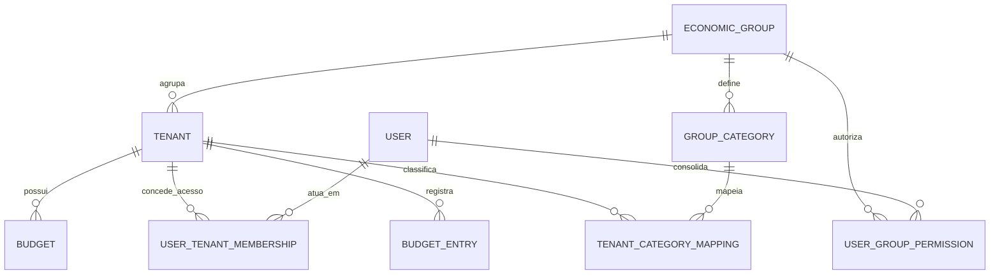
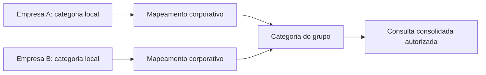

# Multitenancy e grupos econômicos

## Decisão

O Thalamus 2.0 é multitenant desde o início.

- **Tenant** é uma empresa jurídica que opera o ERP, identificada pelo seu cadastro legal.
- **Grupo econômico** reúne uma ou mais empresas. Ele habilita visão consolidada e regras corporativas autorizadas; não transforma os dados das empresas em dados compartilhados.
- Um lançamento, documento, estoque, orçamento, arquivo, evento ou integração pertence a **um único tenant**.
- Um usuário pode atuar em uma ou mais empresas e, quando autorizado, consultar consolidações de um ou mais grupos econômicos.

O modelo inicial é **banco compartilhado por ambiente, schema por módulo e `tenant_id` em cada tabela de negócio**. Não haverá schema ou instância por empresa na primeira versão.

Essa decisão combina isolamento lógico forte, custo operacional adequado ao estágio atual e caminho de evolução para clientes grandes que exijam banco dedicado.

## Modelo conceitual



| Entidade | Responsabilidade |
| --- | --- |
| `economic_groups` | Grupo econômico, nome, situação e identificação corporativa |
| `tenants` | Empresa jurídica, dados legais, situação e grupo econômico atual |
| `users` | Identidade da pessoa; não representa uma empresa |
| `user_tenant_memberships` | Papéis e permissões do usuário em cada empresa |
| `user_group_permissions` | Escopo explícito de consolidação: grupo, módulo, ação e empresas alcançadas |
| `group_categories` | Dimensão corporativa para consolidar categorias entre empresas |
| `tenant_category_mappings` | Mapeamento explícito da categoria local para a categoria do grupo |

Uma empresa pode não pertencer a grupo. O grupo pode existir antes de ter empresas. Uma empresa pertence a no máximo um grupo econômico ativo por vez; uma mudança de grupo preserva a auditoria e a vigência do vínculo.

## Isolamento de dados

### Regras obrigatórias

1. Toda tabela de negócio inclui `tenant_id NOT NULL`.
2. Todo índice único de negócio começa por `tenant_id`. Exemplo: orçamento usa `(tenant_id, category_id, period)`.
3. Todo registro criado recebe o tenant do contexto autenticado no servidor; o corpo HTTP não escolhe o tenant.
4. Toda busca filtra o tenant autorizado antes de receber filtros funcionais. Não existe endpoint genérico que retorna todos os tenants.
5. O identificador do tenant aparece em eventos, jobs, logs, arquivos, auditorias, cache e mensagens de fila.
6. Worker e scheduler falham de forma segura se um job não trouxer `tenant_id`.
7. Integração externa usa credenciais por tenant. Webhook identifica e valida o tenant antes de processar o evento.
8. Arquivo é armazenado em prefixo por ambiente e tenant (`<ambiente>/<tenant-id>/...`), e URL assinada verifica o mesmo escopo.

O banco é MySQL, que não oferece política de linha nativa equivalente a RLS. Por isso, o isolamento é responsabilidade do domínio e da camada de persistência:

- middleware resolve o contexto autenticado;
- `TenantContext` imutável acompanha request, comando e job;
- repositórios exigem `TenantId` como argumento;
- testes de arquitetura proíbem consulta sem escopo;
- testes de integração criam dois tenants e verificam que um nunca lê ou altera o outro.

O usuário do banco da aplicação continua limitado ao schema do módulo. O isolamento por tenant é adicional e não substitui essa permissão.

## Autorização

O schema `t2_core` do `thalamus-2-core` mantém usuários, empresas, grupos, funcionalidades, perfis e vínculos. O contrato está em `docs/contrato-backend-core.md`.

Há dois escopos independentes:

| Escopo | Exemplo | Regra |
| --- | --- | --- |
| Empresa | Financeiro altera o orçamento da Empresa A | Associação do usuário à Empresa A e permissão do módulo |
| Grupo econômico | Diretoria vê o consolidado de A + B | Permissão explícita no Grupo X, no módulo Orçamentos e na ação `consultar_consolidado` |

Permissão de grupo não concede automaticamente autorização operacional em cada empresa. Ela dá apenas as ações declaradas, inicialmente de consulta e exportação consolidada.

No login, o usuário escolhe o contexto ativo:

- **Empresa:** todas as telas e mutações operam somente naquele tenant.
- **Grupo econômico:** disponível apenas para ações que aceitam consolidação. Não é contexto válido para criar pedido, movimentar estoque, lançar título ou alterar orçamento de uma empresa.

Para mutações, a API exige sempre um tenant-empresa. Para consulta consolidada, a API resolve internamente a lista de empresas permitidas e registra na auditoria o grupo e os tenants abrangidos.

## Orçamentos no grupo econômico

O orçamento é definido e executado por empresa. A consulta do grupo soma os dados das empresas autorizadas em uma dimensão corporativa.



Exemplo: Empresa A pode usar `03.01 - CMV` e Empresa B `501 - Material direto`. Ambas são mapeadas para `CMV` no grupo. A consolidação não compara códigos locais por texto.

Regras:

- `budgets`, `budget_entries`, `budget_exceptions`, `budget_alerts` e `budget_audits` recebem `tenant_id`.
- A consulta individual retorna só o tenant ativo.
- A consulta consolidada recebe `economic_group_id`, exige `consultar_consolidado` e retorna totais por categoria corporativa, empresa e período.
- Categorias locais não mapeadas aparecem como **Não classificada no grupo**, nunca são silenciosamente excluídas.
- O saldo, bloqueio e aprovação de exceção continuam na empresa de origem. Não existe saldo operacional compartilhado por grupo nesta fase.
- Um orçamento corporativo próprio, com alocação entre empresas, é uma evolução futura e terá entidade separada (`group_budgets`). Não será inferido somando orçamentos locais.

## API e contratos

Convenções mínimas:

```text
GET  /api/tenants                         # empresas que o usuário pode acessar
POST /api/session/active-tenant           # escolhe empresa ativa
GET  /api/economic-groups                 # grupos em que o usuário possui permissão
GET  /api/budgets?period=2026             # usa somente o tenant ativo
GET  /api/group-budgets/{groupId}?period=2026
                                          # requer consultar_consolidado
```

Não aceitar `tenant_id` livre em endpoint de usuário comum. Em operações administrativas corporativas, ele só pode ser selecionado quando a política autorizar explicitamente.

Todo contrato de backend por módulo deve declarar:

1. quais recursos levam `tenant_id`;
2. qual papel pode operar por empresa;
3. se há consulta consolidada de grupo;
4. qual dimensão corporativa mapeia os dados locais;
5. como o contexto segue para job, evento, cache, arquivo e integração.

## Infraestrutura

| Camada | Regra multitenant |
| --- | --- |
| Banco | Um MySQL por ambiente; schemas por módulo; tabelas com `tenant_id`, índices compostos e backups testados |
| Redis | Prefixo por ambiente, módulo e tenant; locks incluem tenant |
| Fila | Payload contém `tenant_id`; filas podem ser separadas por módulo, não por empresa inicialmente |
| Cache | Chave inicia por `<ambiente>:<modulo>:<tenant-id>` |
| Arquivos | Prefixo por tenant e URL assinada autorizada |
| Logs e métricas | `tenant_id`, `economic_group_id` quando houver, `request_id` e versão da release |
| Backup e recuperação | Recuperação por ambiente; procedimento documentado para localizar dados de um tenant sem expor outro |

Escala ou exigência contratual podem justificar banco dedicado para um tenant. A interface para isso fica no `TenantConnectionResolver`; os módulos não escolhem conexão diretamente.

## Testes obrigatórios por módulo

- criar o mesmo código de negócio em duas empresas e provar que não conflita;
- usuário da Empresa A não lê, altera, exporta nem recebe evento da Empresa B;
- usuário de grupo só enxerga as empresas incluídas na sua permissão;
- consolidado soma apenas categorias corporativas mapeadas e destaca não mapeadas;
- job, evento, cache, arquivo e webhook preservam ou validam o tenant;
- auditoria registra tenant, grupo quando aplicável, usuário, origem e horário.

## Sequência de implantação

1. Criar, no `thalamus-2-core`, o schema `t2_core` com empresas, grupos econômicos, usuários, associações, permissões e `TenantContext`.
2. Incluir `tenant_id` no primeiro módulo que sair do mockup, antes da primeira migration de negócio desse módulo.
3. Criar categorias corporativas e o mapeamento local antes da tela consolidada.
4. Publicar primeiro a visão individual por empresa.
5. Publicar a visão de grupo como consulta autorizada, sem permitir mutação no contexto de grupo.
6. Avaliar orçamento corporativo próprio apenas depois de validar a consolidação.

## Decisões deliberadamente adiadas

- empresas do grupo compartilharem estoque, pedido, título ou outros registros operacionais;
- orçamento corporativo que distribui saldo entre empresas;
- uma empresa pertencer simultaneamente a vários grupos;
- banco dedicado por cliente como padrão;
- consolidação cambial entre empresas de moedas diferentes.
