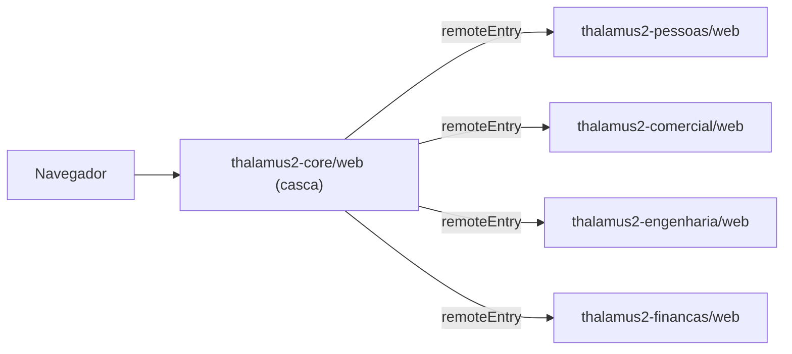
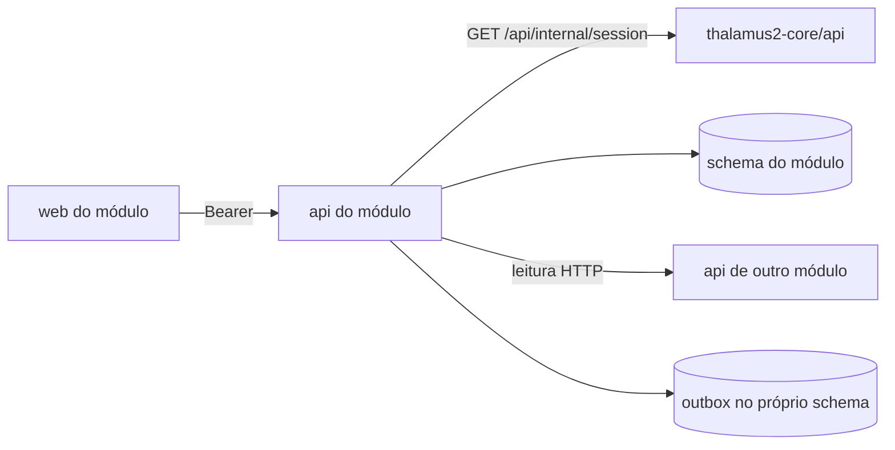

# Repositórios do Thalamus 2.0 oficial

Decisão de 04/11/2026. Substitui o "um Laravel só" e o "uma SPA só" que constavam em `docs/infraestrutura-deploy.md`.

O Thalamus 2.0 passa a existir em duas formas:

| Forma | Onde | Dados | Para quê |
| --- | --- | --- | --- |
| Mockup geral | `thalamus-2.0` (este repositório) | `localStorage` e seed | Desenhar e revisar todos os módulos. Continua completo e navegável |
| Sistema oficial | Repositórios `thalamus2-*` | Banco real, cadastrado pela tela | Operar. Recebe só o módulo que já foi revisado no mockup |

Um módulo só vai para o oficial depois de revisado aqui. O mockup continua sendo o lugar onde a regra nasce.

## Padrão de nomes

Um repositório por módulo: `thalamus2-<modulo>`, em kebab-case, sem ponto e sem acento. Dentro dele, backend e frontend ficam lado a lado:

```text
thalamus2-comercial/
  api/   Laravel do módulo (schema t2_comercial)
  web/   frontend remoto Vue do módulo
  README.md
  AGENTS.md
```

- Produto: `thalamus2`. `thalamus-*` sem número são os legados, só para consulta.
- Fora do padrão `thalamus2-<modulo>`, dois repositórios de apoio: `thalamus2-shared` (pacotes compartilhados, `ui/` e `kernel/`) e `thalamus2-infra` (ambiente local, manifestos e runbooks). Não são módulos e não têm `api/` nem `web/`.
- Módulo: o id do módulo da home (`navigation.ts`): `pessoas`, `engenharia`, `comercial`, `financas`, e assim por diante.
- Cada pasta gera a própria imagem Docker e o próprio deployment, com o sufixo da camada: `devroboflex/thalamus2-comercial-api` e `devroboflex/thalamus2-comercial-web`.
- Uma mudança do módulo (regra na API e tela no web) entra num único pull request.

O ponto (`thalamus2.0-...`) foi descartado porque atrapalha imagem Docker, pacote npm, namespace Kubernetes e DNS.

## Repositórios

| Repositório | Papel | Schema | Porta local (api / web) |
| --- | --- | --- | --- |
| `thalamus2-core` | `api`: login, usuário mestre, empresas, grupos econômicos, perfis, permissões, cofre Omie; valida a sessão para os outros backends. `web`: casca com login, home, menu, troca de empresa, usuários e perfis, empresas e integração Omie; carrega os módulos | `t2_core` | 8000 / 5170 |
| `thalamus2-pessoas` | Setores, cargos, posições, colaboradores, vagas, candidatos, admissão, desligamento | `t2_pessoas` | 8001 / 5171 |
| `thalamus2-comercial` | Parceiros (clientes, fornecedores, transportadoras) e CRM (oportunidades, funil, agenda, propostas) | `t2_comercial` | 8002 / 5172 |
| `thalamus2-engenharia` | Produtos, classes, estruturas, ciclo de vida e dados fiscais do item | `t2_engenharia` | 8003 / 5173 |
| `thalamus2-financas` | Orçamento anual por setor e categoria | `t2_orcamentos` | 8004 / 5174 |
| `thalamus2-shared` | Pacotes compartilhados. `ui/` (npm): design system, componentes base, cliente HTTP com sessão, ícones e formatadores. `kernel/` (composer): sessão do core, tenant, funcionalidade, auditoria, outbox e chamada entre módulos | — | — |
| `thalamus2-infra` | `docker compose` local, manifestos Kubernetes e runbooks | — | — |

O `thalamus-2-core` virou a pasta `api` de `thalamus2-core`.

### Ficam só no mockup, por enquanto

Compras, Requisições, Almoxarifado, Operações, Serviços e Contratos (assistência), Patrimônio, Gestão, títulos a pagar e a receber, e Postos. O catálogo de Serviços fica na Engenharia (`/servicos`) e o DRE fica em Finanças (`/dre`). Postos tem contrato e continua no mockup: o roteiro do produto depende dele.

## Frontend: casca e módulos remotos



- A casca usa Module Federation (`@module-federation/vite`). Cada módulo publica um `remoteEntry.js` e expõe `./module`: rotas, itens de menu e o manual do módulo.
- `vue`, `vue-router`, `pinia` e `thalamus2-ui` são compartilhados como singleton. O módulo não traz o próprio Vue.
- O endereço de cada remoto vem de `/config.js` na subida do contêiner, para a mesma imagem servir homologação e produção.
- Se um remoto não responde, a casca mostra o módulo como indisponível e o resto do sistema continua.
- A sessão (token, refresh e empresa ativa) é da casca. O módulo lê pelo cliente HTTP do `thalamus2-ui`.

## Backend: um Laravel por módulo



- O navegador fala com a API do módulo levando o token emitido pelo core.
- A API do módulo resolve a sessão no core (`GET /api/internal/session`, protegido por chave interna) com cache curto. Recebe usuário, empresa ativa e funcionalidades. Nunca aceita `tenant_id` vindo do navegador.
- Cada API usa só o próprio schema, com usuário MySQL que só tem permissão nele.
- Dado de outro módulo chega por leitura HTTP (o `InternalClient` do kernel repassa o token do usuário, então a permissão continua valendo) ou por evento de outbox.
- Toda tabela de negócio tem `tenant_id`. Índice único inclui `tenant_id`.
- Erro sempre como `{ message, error }`.

### Dependências entre módulos

| Quem lê | De quem | O quê |
| --- | --- | --- |
| Finanças | Pessoas | Setores (o orçamento é por setor) |
| Comercial (propostas) | Engenharia | Produtos vendáveis e preço de referência |
| Comercial (CRM) | Comercial (parceiros) | Clientes, no mesmo schema |
| Todos | Core | Sessão, empresa, permissões |

Quando Suprimentos for oficializado, ele lê Fornecedores pela API do Comercial e não terá cadastro próprio.

## Dados reais

- O oficial sobe com banco vazio. `php artisan core:install-master` cria o mestre; o mestre cadastra a empresa e o Admin. O restante entra pela tela.
- Não há seed de demonstração no oficial nem `localStorage` como fonte de dado.
- Toda tela tem estado vazio com o botão para cadastrar o primeiro item.
- A API do Omie é chamada pela API do módulo dono do dado, com a chave do cofre do core. Enquanto a chamada real não existe, a tela diz que a sincronização está pendente; não finge sucesso.

## Homologação e produção

O mockup é a homologação: a regra e a tela nascem e são revisadas aqui, com dados de demonstração. O oficial é a produção: as **mesmas telas**, com banco real. A diferença entre os dois se limita ao que um sistema real exige:

- login, sessão e troca de empresa (core);
- permissões vindas do perfil, validadas na API, nunca só na tela;
- persistência na API do módulo, no lugar de `localStorage`;
- campos que só existem no real (por exemplo, senha inicial da conta).

Fica escondido no oficial, e listado no contrato do módulo, o que depende de módulo que ainda não é oficial ou de integração que ainda não existe. A casca mostra "Em breve" para os itens de navegação sem módulo oficial.

O catálogo de funcionalidades do core (`FunctionalityCatalog.php`) é o mesmo de `src/domain/access.ts`. Mudou um, muda o outro.

### Como uma mudança sai do mockup

1. Contrato `docs/contrato-backend-<modulo>.md` revisado, com a seção "Entrega oficial" dizendo o que está no oficial, o que ficou escondido e o que é simulação.
2. Regras de `src/domain` viram serviços em `api/`, com teste PHPUnit para cada teste de `src/tests` que cobre a regra.
3. As views do mockup são **copiadas** para `web/`, o mais literal possível. Cada `web/` tem um adaptador (`src/stores/<modulo>.ts`) que carrega da API e expõe a forma da store do mockup, para a cópia mudar pouco. Rotas e `meta.title` iguais às do mockup.
4. O CSS não é copiado por módulo: `thalamus2-shared/ui/scripts/sync-mockup.ps1` copia o `style.css` e os tokens do mockup para `thalamus2-shared/ui/src/mockup/`. Classe nova no mockup chega ao oficial rodando o script. `official.css` só tem as classes que o mockup não tem (login, módulo fora do ar).
5. Manual do módulo vai no manifesto do `web/` (`defineModule`).
6. Pronto quando testes e build passam nas duas pastas do módulo e o fluxo é feito de ponta a ponta no navegador, comparado com o mockup.

### Grupo econômico no oficial

A sessão do core (`/api/internal/session` e `/api/me`) devolve `group_tenants` (empresas ativas do grupo da empresa ativa) e `economic_group`. No kernel, `CurrentSession::readableTenantIds($funcionalidadeConsolidada)` devolve essas empresas só para quem tem a funcionalidade consolidada (`crm.consultar_consolidado`, `orcamentos.consultar_consolidado`, `organizacao.consultar_consolidado`); sem ela, só a empresa ativa. Leitura de grupo é consulta derivada; a escrita continua na empresa ativa.

## Verificação por repositório

Em `web/` e em `thalamus2-shared/ui`:

```bash
npx vue-tsc --noEmit
npx vitest run
npm run build
```

Em `api/` e em `thalamus2-shared/kernel`:

```bash
composer validate
php artisan test
```

## Subir tudo na máquina

Com Docker: `docker compose up` em `thalamus2-infra/local`. Sobe o MySQL com os cinco schemas e um usuário por schema, as cinco APIs e os cinco frontends.

Sem Docker: `thalamus2-infra/local/dev.ps1` sobe cada `api/` com SQLite próprio (um arquivo por schema) e cada `web/` com `npm run dev`.
